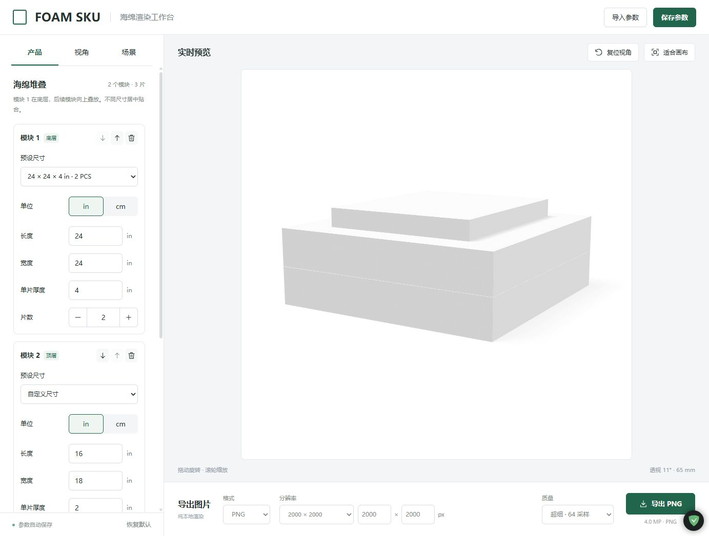

# FOAM SKU

可在本机运行的海绵商品图渲染工作台。React + Three.js，模型、细孔纹理和灯光都由浏览器实时生成；图片与参数保留在本地，无需 API Key。



## 本地启动

需要 Node.js 22.12+（推荐 24 LTS）和支持 WebGL 2 的现代浏览器。Windows 可双击 **`start-local.cmd`**：安装缺少的依赖、构建并启动本地服务。

也可以在项目目录运行：

```sh
npm ci
npm run build
npm start
```

打开 **http://127.0.0.1:4173/**。服务仅监听本机回环地址。命令行启动时按 `Ctrl+C` 停止。若该端口上已经是本工具，重复启动会提示现有地址。

开发模式：`npm run dev` → http://127.0.0.1:5173/。

## 可以调整什么

| 分组 | 参数 |
| --- | --- |
| 产品 | 可增删和换序的海绵模块；每个模块独立设置预设、英寸/厘米、长/宽/单片厚度及 1–12 片；共用圆角、细孔、颜色和材质 |
| 视角 | 5–85° 仰角、方位角、28–120 mm 透视镜头、画面占比、预设视角、鼠标拖动、滚轮缩放 |
| 场景 | 纯色/透明背景、背景色预设、地面阴影开关、阴影浓度/柔和度、整体亮度、顶部补光 |
| 导出 | PNG / JPEG、1024/2000/3000/4096 预设、自定义宽高、16/32/48/64 采样、进度与取消 |

默认参数取自用户在 Chrome 保存的设置：**11° 仰角 / 65 mm 焦距**、画面占比 0.84、圆角 0.7 mm、细孔强度 0、细孔大小 0.66、整体亮度 1.02、顶部补光 0.32、2000×2000 PNG / 64 采样。默认产品仍为 24×24×4 in 的双片海绵。

- 可添加最多 12 个模块，每个模块 1–12 片；模块 1 在底层，后续模块向上叠放。用箭头调整上下位置、垃圾桶删除模块，至少保留一个模块。
- 新模块沿用最上方模块的尺寸和单位，初始 1 片，可独立改成不同长宽或厚度。所有海绵中心对齐，累计各模块高度计算位置，层间无额外间距。圆角、材质、场景和镜头对整组生效。
- 尺寸内部使用厘米，各模块可分别切换英寸/厘米，切换单位不会改变实际模型。厚度指每片厚度。
- 圆角会受短边和厚度限制，避免薄片穿插。细孔大小以默认物理纹理尺度的倍数表示。
- 透明模式自动使用 PNG；棋盘格不会导出，地面阴影可以保留为半透明像素。JPEG 使用所选纯色背景。
- 导出边长范围为 **256–4096 px**，宽高独立；预览保持相同宽高比和构图。图片会重新按目标像素渲染，不是截图放大。
- 参数变更后预览自动更新；导出期间冻结参数，可以取消。浏览器按自己的下载设置保存文件。
- 文件名自动包含尺寸、单位、片数、分辨率与透明标记，例如 `foam_24x24x4in_2pcs_2000x2000_alpha.png`。混合堆叠按从下到上列出各模块规格；名称过长时改用模块数，完整规格保存在 JSON 中。
- “保存参数”导出版本 2 JSON；“导入参数”恢复所有模块和顺序，也兼容版本 1 的单规格文件。浏览器中的版本 1 设置会自动迁移到版本 2，旧存档保留。
- 参数会自动存到当前浏览器、当前站点地址的 localStorage。“恢复默认”回到上述 Chrome 参数和一个默认模块。

预览采用 16 次光照采样并限制像素数，导出使用所选采样和完整分辨率。4K 导出需要较多显存；浏览器若提示显卡上下文丢失，刷新后降低分辨率。此版本生成规则长方体海绵，不模拟真实产品的压缩变形、切口或不规则缺陷。

## 验证

```sh
npm test
npm run build
npm run test:e2e
```

浏览器测试默认使用 Windows 上已安装的 Edge。其他平台可安装 Playwright Chromium 后设置 `PLAYWRIGHT_CHANNEL=chromium` 运行。浏览器测试覆盖真实 PNG/JPEG 下载、alpha 通道、地面阴影、自定义尺寸、4K、参数往返、取消、移动端与模块增删换序；数学测试覆盖单位、输入校验、旧配置迁移、混合规格贴合堆叠、圆角外尺寸和极端宽高比。

测试截图输出到被忽略的 `.local/qa/`，测试报告位于 `test-results/`。

## 后续远端部署

当前版本是纯静态前端，**此轮只启动本地服务，没有发布远端网站**。后续执行 `npm ci && npm run build`，将 `dist/` 发布到静态托管即可。Vite 使用相对资源路径，也可放在 `/FOAM-SKU/` 子路径。参数保存按域名隔离，可通过 JSON 在本地和远端间迁移。

## 代码结构

- `src/config.js`：参数范围、预设、单位换算和配置校验。
- `src/render/`：程序化细孔材质、圆角几何、相机拟合和保留 alpha 的 GPU 累积渲染。
- `src/components/`：产品/视角/场景控制、预览、导出区域。
- `scripts/local-server.mjs`：只监听本机的静态服务器。
- `docs/design.md`：已实现的设计范围。

Three.js 渲染约定参考 [Three.js 官方文档](https://threejs.org/docs/)，构建与静态发布参考 [Vite 官方指南](https://vite.dev/guide/)。
